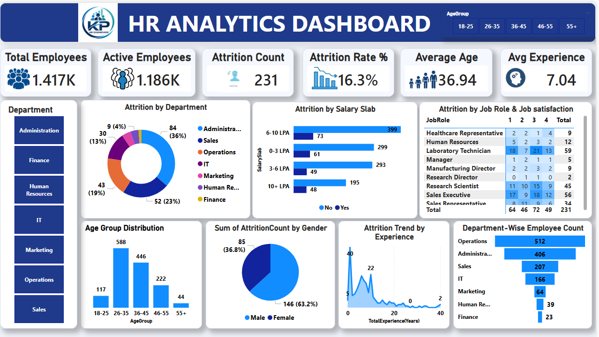

# HR-Analytics-PowerBI
Interactive HR Analytics Dashboard built using Microsoft Power BI to analyse workforce demographics, employee attrition, salary distribution, job satisfaction, and departmental performance. Features interactive filters and KPIs to support data-driven HR decision-making.
## Dashboard Preview

## Key Performance Indicators (KPIs)

Total Employees: 1,417

Active Employees: 1,186

Attrition Count: 231

Attrition Rate: 16.3%

Average Age: 36.94 years

Average Experience: 7.04 years

## Dashboard Features

Employee attrition analysis by department

Attrition by salary slab and job role

Job satisfaction analysis

Employee distribution by age group and gender

Attrition trends by years of experience

Department-wise employee analysis

Interactive filters for department and age group

## Tools and Technologies

Microsoft Power BI

Power Query for data cleaning and transformation

DAX for calculations and KPIs

Data visualisation and dashboard design

## Project Objective

To analyse employee attrition and workforce patterns through interactive visualisations, identify trends across departments and job roles, and support data-driven HR planning and employee retention strategies.
